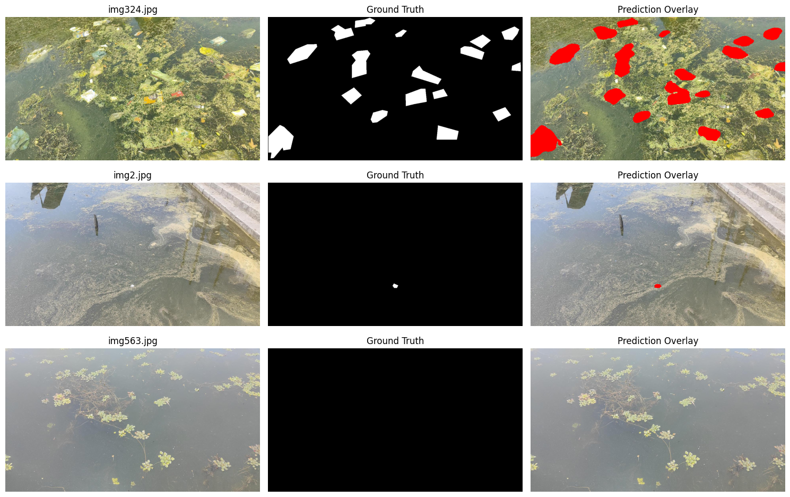
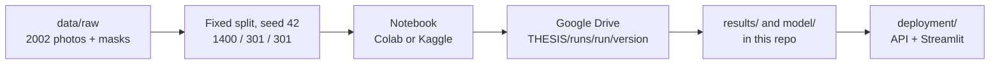

<h1 align="center">PDIS-Net</h1>

<p align="center">
  <b>Plastic Debris Image Segmentation</b><br>
  Finding floating plastic in drone photos of Dal Lake, one pixel at a time.<br>
  <sub>Undergraduate thesis project · BINUS University</sub>
</p>

<p align="center">
  
  <br>
  <sub>Drone photo, hand-drawn mask, and the model's prediction in red. From the top: lots of litter, one tiny piece,
  and clean water (training-set examples).</sub>
</p>

---

## What this is

Give the model a drone photo of the lake, and it gives back a mask of every pixel it thinks is floating plastic.
That's the whole task: two classes, plastic and background.

We use the **FloPWD 2025** dataset (Dal Lake Floating Plastic Waste Detection): 2002 photos at 1280×720, each with
a hand-drawn mask. Most of the work is comparing architectures, encoders and pretraining on the same data split,
then trying to squeeze more out of the best one.

Everything trains in Colab or Kaggle notebooks. The weights and scores of every run are kept in this repo, so any
number in the thesis can be traced back to the exact notebook that produced it.

## Where we are

Our best model is **SegFormer with a MiT-B3 encoder, pretrained on ImageNet** (run `02`), trained with the settings
our Optuna search found (**v4-final**, 0.8320 mIoU). That's 0.011 above the original training (v1), and the gap holds
up when we resample the test photos (95% range +0.002 to +0.019). It's still under our 0.02 bar, though, and v4-final
trained for 80 epochs where v1 trained for 40, so part of the gain may simply be the longer training.

After the main comparison grid, we spent a few weeks trying to beat it. Every attempt below is scored the same way:
mIoU per photo at threshold 0.5, on **the same 301 test photos**.

| Run 02 version | What we changed | mIoU |
|---|---|---|
| **v4-final** | v4's best settings, 80 epochs, no early stop | **0.8320** |
| v1 | baseline, 40 epochs | 0.8210 |
| v3 | Optuna search, 12 trials | 0.8177 |
| curriculum A | clean photos first, the rest from epoch 21 | 0.8169 |
| clean | 94 badly labelled photos removed | 0.8087 |
| curriculum B | same as A, different seed | 0.8048 |
| v4 | Optuna search, 24 trials | 0.7810 |

What we learned along the way:

- **Throwing away messy labels didn't help.** Some photos have loose "zone" masks drawn over grass and water.
  Removing them cost about 0.01 mIoU; those photos still teach the model what dense litter looks like.
- **Showing the clean photos first didn't help either.** The curriculum runs tied the baseline at best.
- **Hyperparameter search works, but only if the final run can finish.** v4 found good settings, then early stopping
  cut the final training at epoch 16 while the learning rate was still high. Training the same settings
  for 80 epochs without early stopping (v4-final) took it from 0.04 behind v1 to 0.011 ahead, and it was still
  improving at the last epoch.
- **Luck is about ±0.01.** Two runs with the same settings and a different seed moved by that much, so we treat
  gaps under 0.02 as a tie.

The per-run details are in [`notebooks/02-segformer-mitb3-imagenet/curriculum-learnings/`](notebooks/02-segformer-mitb3-imagenet/curriculum-learnings/README.md)
and the full leaderboard is in [`model/README.md`](model/README.md).

## The comparison grid

Runs `01` to `17` change one thing at a time: the architecture, the encoder or the pretrained weights. A few things
stood out:

- **Pretraining matters more than anything else.** The same SegFormer MiT-B3 scores 0.47 mIoU from scratch and 0.82
  with ImageNet weights. Aerial (0.81), ADE20K (0.81) and drone (0.78) weights didn't beat plain ImageNet.
- **Bigger isn't automatically better.** MiT-B5 (0.81) didn't beat MiT-B3, and MiT-B0 dropped to 0.76.
- **SegFormer edges out the others** on the same encoder: DeepLabV3+ (0.81) and U-Net (0.79) with MiT-B3.

## How it fits together



Every run uses the same train / val / test split (a stratified split with seed 42), so scores are comparable
across runs. The split is also written down per photo in `data/clean/manifest.csv`.

## Repo layout

```
data/          raw FloPWD photos and masks, plus the cleaned-label manifest
notebooks/     one folder per run: 02-segformer-mitb3-imagenet/v1.ipynb, ...
  v2.ipynb       template for normal training
  v3.ipynb       template for Optuna search
  v4.ipynb       Optuna search, fixed metric and learning-rate decay
  .kaggles/      the same templates, adjusted for Kaggle
results/       scores, training curves and sample predictions per run and version
model/         best.pth weights per run and version (Git LFS)
xai/           Seg-Eigen-CAM heatmaps that show what the model looks at
eda/           dataset statistics and overlays
deployment/    inference server and Streamlit client
```

## Running a notebook

1. Copy the template you need into the run's folder, for example `notebooks/02-segformer-mitb3-imagenet/`.
2. Set `arch`, `init` and `backbone` in the `CFG` cell, and give it a new `run_version`.
3. Open it in Colab with a T4 GPU and choose **Run all**. Results save to `THESIS/runs/<run>/<version>/` on Drive.
4. Download that folder and put the files in `results/` and `model/`, then run `python model/build_index.py` to
   update the leaderboard.

On Kaggle, use the notebook from `notebooks/.kaggles/`, turn Internet on and use **Save & Run All**. Otherwise
the outputs can't be downloaded afterwards.

## Deployment

`deployment/server` is a small inference API and `deployment/client` is a Streamlit app that calls it. The server
pulls its weights from [adamantix/pdisnet-weights](https://huggingface.co/adamantix/pdisnet-weights) on the
Hugging Face Hub. The deployed checkpoint is an earlier SegFormer MiT-B3 (test mIoU 0.811).
