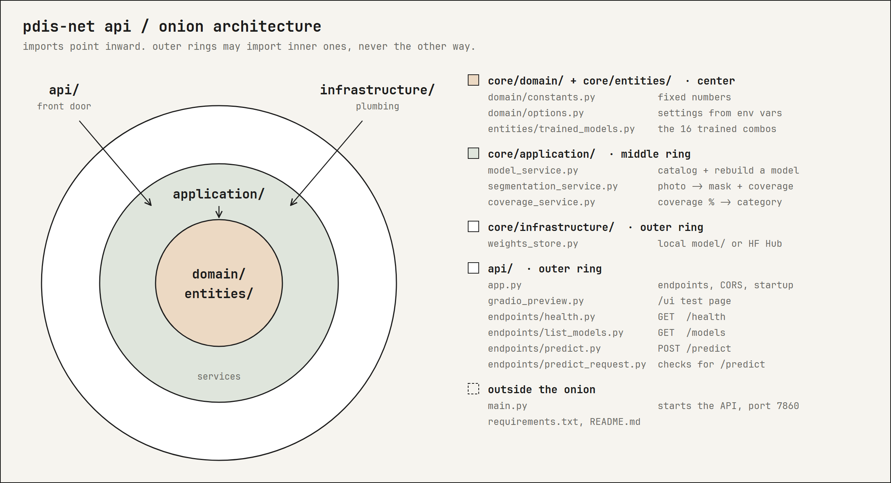

# PDIS-Net API

Floating plastic segmentation on aerial photos (FloPWD 2025). 16 trained models: pick arch, backbone and pretrained weights.
Best: SegFormer MiT-B3 (ImageNet), test mIoU **0.832**.

Weights: [adamantix/pdisnet-weights](https://huggingface.co/adamantix/pdisnet-weights).

## Endpoints

- `GET /health` — status, device, how many models are available
- `GET /models` — every trained combo with its test mIoU and threshold
- `POST /predict` — multipart: `file`, `arch`, `backbone`, `init` → mask (base64 PNG), coverage %, category, recommendation
- `/ui` — small Gradio test page

## Architecture



Onion architecture: imports point inward. Outer rings may import inner ones, inner rings never import outer ones.
Swapping the Hugging Face Hub for a local folder, or FastAPI for something else, never touches the center.

```
deployment/server/
├── main.py                          # outside the onion: starts the API on port 7860
├── requirements.txt
├── README.md
├── docs/architecture.png
├── api/                             # outer ring: the front door (HTTP)
│   ├── app.py                       #   wires endpoints, CORS, startup checks
│   ├── gradio_preview.py            #   /ui test page
│   └── endpoints/                   #   one file per endpoint
│       ├── health.py                #     GET  /health
│       ├── list_models.py           #     GET  /models
│       ├── predict.py               #     POST /predict
│       └── predict_request.py       #     response shape + input checks for /predict
└── core/
    ├── infrastructure/              # outer ring: plumbing (talks to the outside world)
    │   └── weights_store.py         #   weights from the local model/ folder or the HF Hub
    ├── application/                 # middle ring: services (what the system does)
    │   ├── model_service.py         #   model catalog + rebuild a model from best.pth
    │   ├── segmentation_service.py  #   photo -> mask + coverage + category
    │   └── coverage_service.py      #   coverage % -> category + recommendation
    ├── domain/                      # center: fixed rules
    │   ├── constants.py             #   input size, ImageNet mean/std, coverage cut-offs
    │   └── options.py               #   settings from environment variables
    └── entities/                    # center: what the system is about
        └── trained_models.py        #   the 16 trained arch/backbone/init combos
```
