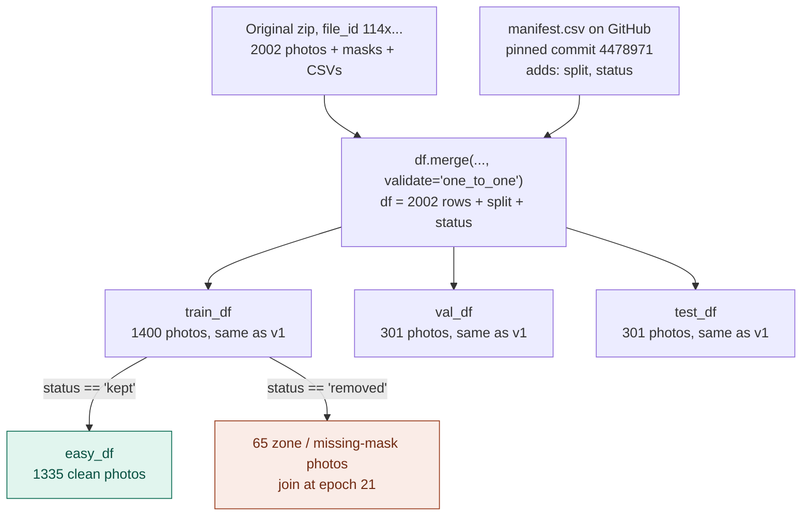
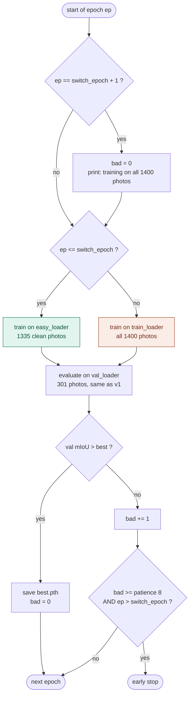

# Curriculum learning: run 02 (SegFormer MiT-B3, ImageNet init)

`v2-curriculum.ipynb` trains the same model and recipe as baseline `02 v1`, and changes one thing: the
**order** the training photos arrive in. Epochs 1-20 see only the clean photos. From epoch 21, the 65 photos
with coarse "zone" labels (or missing masks) join. Val and test are exactly v1's at every epoch.

## Why

- **Phase 1 (data cleaning, done):** we removed the 94 zone / missing-mask photos (`data/clean/`) and retrained.
  On the same 290 test photos it scored **0.8162 mIoU vs 0.8250 for v1** (-0.009). Throwing the photos away
  didn't help.
- **Phase 2 (this notebook):** keep the photos, but teach them last. The model first learns what clean plastic
  looks like, then sees the loose zone labels.

## 1. How the data is built (Split section)



| Table | Photos | Used for |
|---|---|---|
| `easy_df` | 1335 | training, epochs 1 to `switch_epoch` |
| `train_df` | 1400 (1335 + 65 zone) | training, after `switch_epoch` |
| `val_df` | 301 | picking the best epoch, every epoch (same as v1) |
| `test_df` | 301 | final score (same as v1); also re-scored on the 290 clean ones |

- The manifest is read from GitHub because the original zip has no `cleaning/` folder. The link is pinned to one
  commit, so the file can never change under the notebook.
- `validate="one_to_one"` makes pandas crash if a photo name appears twice, instead of silently copying it.
- The counts cell must print `(1335, 1400, 301, 301)`. A second number of 1335 means the clean zip was downloaded
  instead of the original one.

## 2. What one epoch does (Main Loop section)



With the default `switch_epoch = 20`:

```
epoch        1 ......................... 20 | 21 ......................... 40
photos       easy_df: 1335 clean            | train_df: 1400 (+65 zone)
early stop   off                            | on, patience counter starts again at 0
```

Why the two guards around the switch:

- **`bad = 0` at epoch 21:** if the clean stage went flat, `bad` could already be 9. Then the first stage-2 epoch
  that doesn't improve would stop the run, before the zone photos did anything.
- **No early stop before the switch:** 8 flat clean epochs would otherwise end the run in stage 1. The zone photos
  would never join, and the run would just be phase 1 again.

One knob, three experiments (checked with a dry run: real data plus a fake model):

| `switch_epoch` | The run is | Dry run: epochs trained (clean / all) |
|---|---|---|
| `0` | plain full-data training = the baseline | same as the old loop, epoch for epoch |
| `20` | the curriculum | 40 (20 / 20); with a flat stage 1: 28 (20 / 8) |
| `40` | clean photos only = phase 1 again | 40 (40 / 0) |

## 3. Runs

One Colab session each, T4 GPU, about 1.8 h. Only the CFG cell changes. The Drive folder is named automatically
(`v2-curriculum-sw{switch_epoch}-s{seed}`), so runs can't overwrite each other.

| Run | `switch_epoch` | `seed` | Compared with |
|---|---|---|---|
| A | 20 | 42 | v1 (seed 42) |
| B | 20 | 43 | C |
| C | 0 | 43 | baseline, 2nd seed |

Two seeds per side, because one run each can't tell "better" apart from "lucky". The seed changes weight init,
data order and augmentations. The split stays fixed because it comes from the manifest.

## 4. Results so far (test mIoU, same metric for all)

| Run | 301 test photos | 290 clean test photos |
|---|---|---|
| v1, full data (baseline) | 0.8210 | **0.8250** |
| v3, Optuna-tuned | 0.8177 | 0.8206 |
| v2-clean-stage1, phase 1 | 0.8087 | 0.8162 |
| A / B / C | pending | pending |
